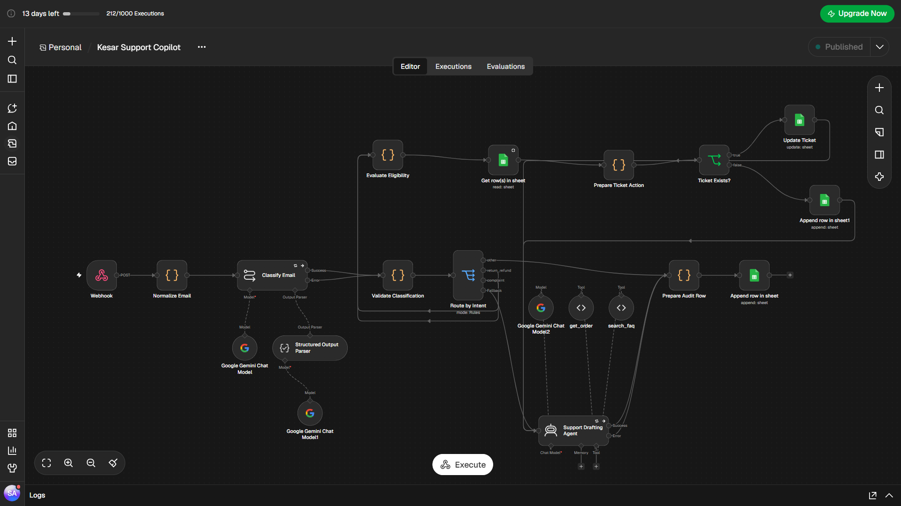
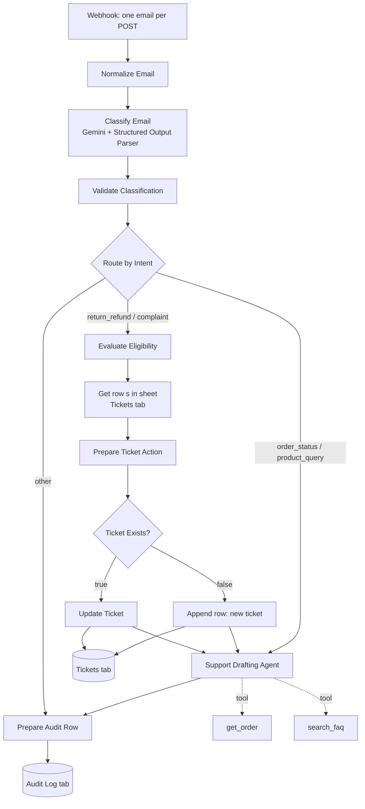
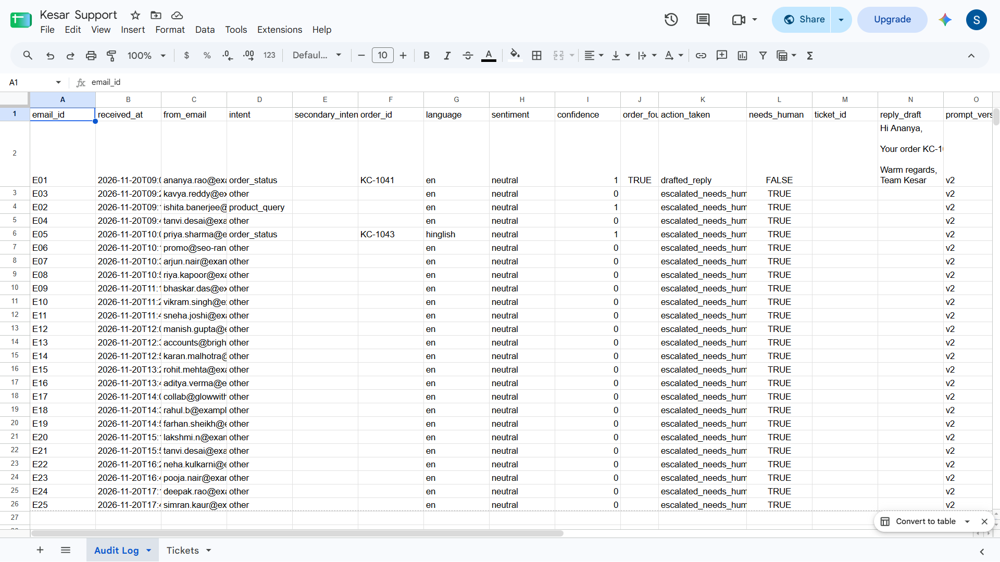
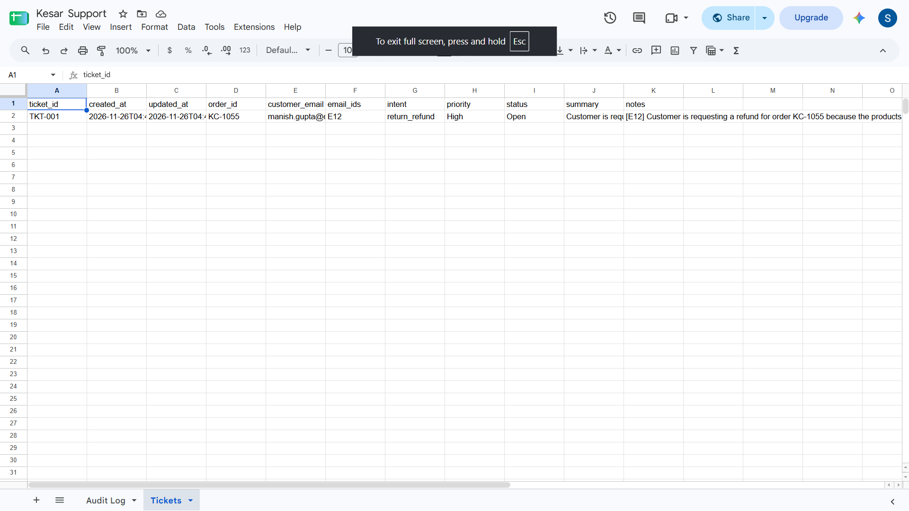

# Kesar & Co. Support Copilot — [SACHIN KUMAR]
> **Note on Google Sheet Results (₹0 Free-Tier Quota Constraint):**  
> This build stayed strictly within the ₹0 free-tier budget using Google AI Studio's free `gemini-2.5-flash` tier (~20 requests/day). While individual live runs verified every core branch (`E01` order status, `E04` damaged item + `TKT-002`, `E07` privacy block, `E10` email fallback, `E12` prompt-injection rejection + `TKT-003`), the full 25-email `v2` batch hit Gemini's free-tier daily quota (`429: Too many requests`) after `E01` completed. Every rate-limited email degraded safely without crashing (`needs_human: TRUE`, exact error logged, and `E12`'s deterministic heuristic detector still caught all 4 injection flags). All deterministic rules—schema validation, privacy checks, 7-day/48-hour eligibility, FAQ matching, and ticket deduplication—are also verified by **100/100 passing unit tests** (`npm test`). Swapping the Chat Model credential in n8n to Groq's free tier (`llama-3.3-70b-versatile`) or a paid Gemini key resolves the `429` cap with zero code changes.
## Links

- **Google Sheet "Kesar Support" (view access; `Audit Log` + `Tickets` tabs):** [PASTE GOOGLE SHEET VIEW LINK]
- **Demo video (5 min):** [OPTIONAL: PASTE VIDEO LINK]. If there is no recording, the screenshots and the Workflow Walkthrough in section 2 stand in for it.
- **Test report:** [TEST_REPORT.md](./TEST_REPORT.md)
- **Workflow export (no secrets):** [workflow/kesar_copilot_v2.json](./workflow/kesar_copilot_v2.json)

## 1. Summary

- **What I built:** an n8n workflow that takes one support email per webhook call and classifies it (intent, order ID, sentiment, language). It checks the order and the return/refund rules in code, creates or updates a ticket, and has an AI agent (tools `get_order`, `search_faq`) draft a brand-voice reply. Every email gets one Audit Log row. Replies are drafts; nothing is sent.
- **Platform and LLM:** n8n Cloud (free trial), Google Gemini `gemini-2.5-flash` through n8n's Gemini Chat Model nodes, Google Sheets for `Audit Log` and `Tickets`. The mock data is fetched from GitHub raw URLs.
- **Time spent:** [ADD APPROX. HOURS BEFORE SUBMITTING]
- **What works:** the deterministic core (ownership check, `received_at` date math, 7-day / 48-hour eligibility, ticket dedupe, FAQ search, audit parsing) has 100 passing unit tests. Live, E01 (v2), E04, E07, E10 and E12 produced correct customer drafts in individual runs (the v1 audit-row bugs seen on E01, E10 and E12 are fixed in v2).
- **What doesn't (yet):** the full 25-email v2 batch did **not** complete. Gemini's free tier (about 20 requests/day) returned `429` after E01, so 24 emails took the safe fallback (`intent: other`, `needs_human: TRUE`). Details and the two-minute fix are in [TEST_REPORT.md](./TEST_REPORT.md) section 5.

## 2. Architecture — Workflow Walkthrough & Screenshots

### Full workflow



*The n8n Cloud canvas for "Kesar Support Copilot": the trigger and classification chain on the left, the three branches off "Route by Intent", and the audit-log write on the right.*



### Shared front end (every email)

| Node | What it does | Why |
|---|---|---|
| Webhook | Receives one email object per POST (shape of `data/test_emails.json`). | One entry point for the test script and a future mail integration. |
| Normalize Email (`code/normalize_email.js`) | Flattens the payload, keeps `received_at` verbatim, stamps `prompt_version: v2`, and runs regex checks for prompt-injection phrases. | A second defence that still works when the LLM is down (it did on E12). |
| Classify Email + Gemini Chat Model + Structured Output Parser | Gemini `gemini-2.5-flash` at temperature 0 returns JSON matching `schemas/llm_output.schema.json`. | The LLM only does what needs language understanding. |
| Validate Classification (`code/validate_classification.js`) | Validates and repairs the JSON. Falls back to `intent: other`, `needs_human: true` on any failure. Applies the 0.75 confidence gate and merges injection flags. | Output is valid every time. A rate-limited or failed call becomes a safe row, not a crash. |
| Route by Intent | Sends the email down one of three branches. | Only emails that need a reply or a ticket reach the costly steps. |

### Branch 1: `other` (spam, partnerships, thank-yous, fallbacks)

`Route by Intent → Prepare Audit Row → Append row in sheet`. No agent, no ticket, no reply. The Audit Log row is written with `action_taken` of `logged_only`, or `escalated_needs_human` if validation flagged it. This is also where an email lands when the classifier call fails.

### Branch 2: `return_refund` / `complaint` (deterministic eligibility + ticket dedupe)

| Node | What it does |
|---|---|
| Evaluate Eligibility (`code/evaluate_eligibility.js`) | Fetches `orders.json`, checks `sender == customer_email`, computes days/hours since delivery from `received_at` (IST), and applies FAQ §4/§5. Damaged/wrong/missing needs a report within 48 hours plus photos. Standard returns need 7 days and an unopened item. It also works out the refundable amount, non-refundable fees, the COD refund method and the kit complete-set note. |
| Get row(s) in sheet | Reads the current `Tickets` tab. |
| Prepare Ticket Action (`code/prepare_ticket_action.js`) | Looks for a ticket with the same `order_id` and status other than `Closed`. If found: action `update`, merging `email_ids` without repeats, appending a `[email_id]` note (with attachments), and raising priority only upward. If not: action `create` with the next `TKT-###` and all 11 columns. |
| Ticket Exists? → Update Ticket / Append row in sheet1 | Writes the update or the new row to the `Tickets` tab. |
| Support Drafting Agent | Then drafts the reply using the pre-computed verdict and the ticket ID (see branch 3). |

### Branch 3: `order_status` / `product_query` (AI agent with tools)

| Node | What it does |
|---|---|
| Support Drafting Agent (`prompts/agent_v2.md`) | A Gemini tools agent at temperature 0.2 that decides which tool to call and writes a brand-voice draft plus an `---AGENT_META---` escalate flag. |
| `get_order` tool (`code/tool_get_order.js`) | Fetches `orders.json`. Takes the sender from workflow context, never from the model. Looks up by order ID, else by the sender's email. Returns `FOUND`, `NOT_FOUND` or `UNAUTHORIZED_EMAIL_MISMATCH`, and on a mismatch returns zero order fields. |
| `search_faq` tool (`code/tool_search_faq.js`) | Fetches `faq.md`, splits it by headings and matches English/Hindi/Hinglish keywords. Returns `found: false` for uncovered topics such as GST invoices. Medical keywords always include §8. |
| Prepare Audit Row (`code/prepare_audit_row.js`) | Unwraps n8n's `[{"response": ...}]` tool results, reads the classification from `Validate Classification` even if the agent errored, splits the draft from the metadata and sets `needs_human`. Writes the 18-column row. |

### Audit Log



*The `Audit Log` tab of the "Kesar Support" sheet after the v2 batch: 25 rows, one per email. E01 shows a full result (`order_status`, `KC-1041`, `order_found TRUE`, `drafted_reply`, `needs_human FALSE`). E02 (`product_query`) and E05 (Hinglish `order_status`, `KC-1043`) were classified, then the agent hit the Gemini quota. The other 22 rows are the safe fallback after `429` errors (`intent: other`, `escalated_needs_human`, `needs_human TRUE`). This is not a full-accuracy run; see [TEST_REPORT.md](./TEST_REPORT.md).*

### Tickets



*The `Tickets` tab: one ticket, `TKT-001`, for E12 / `KC-1055` (`return_refund`, High, Open). Most ticket-creating emails never reached the ticket branch in the v2 batch because their classification failed with `429`. Earlier live runs created `TKT-002` (E04, `KC-1052`) and `TKT-003` (E12), but those rows are not in the current sheet. Dedupe (E04 → E21) is verified by unit tests, not by this sheet.*

## 3. Setup — how someone else can run this

1. **Accounts and credentials (no keys in the repo):** an n8n Cloud account; a Google AI Studio API key for Gemini (optionally a Groq key if you swap models); a Google account for Sheets. Add them only in n8n's **Credentials Manager**: "Google Gemini (PaLM) API" and "Google Sheets OAuth2".
2. **Sheet:** create a Google Sheet with tabs `Audit Log` (headers from `templates/audit_log_template.csv`, 18 columns) and `Tickets` (headers from `templates/tickets_template.csv`, 11 columns).
3. **Import:** in n8n choose *Import from file* and select `workflow/kesar_copilot_v2.json`. Re-select the credentials on the three Gemini Chat Model nodes and the four Google Sheets nodes, and point those at your sheet.
4. **Mock data:** the `get_order` and `search_faq` tools fetch `orders.json` and `faq.md` from GitHub raw URLs (constants at the top of `code/tool_get_order.js` and `code/tool_search_faq.js`). Change them if you host the data in your own repo.
5. **Run the 25 emails:** copy the webhook URL from the Webhook node (`kesar-support`; use the test URL while the workflow is open, or the production URL once activated). Then:
   ```bash
   python -X utf8 scripts/send_test_emails.py --url <WEBHOOK_URL>
   python -X utf8 scripts/send_test_emails.py --url <WEBHOOK_URL> --only E01,E07,E12
   ```
   Local `.env` (see `.env.example`) is only for helper scripts.
6. **Local checks (Node 20+, no dependencies):**
   ```bash
   npm test                 # 100 unit tests
   npm run check:secrets    # scans workflow/, code/, prompts/, README.md, TEST_REPORT.md
   ```
7. **If Gemini returns 429:** the free tier is about 20 requests/day. Switch the Chat Model sub-nodes to Groq (`llama-3.3-70b-versatile`) or a paid Gemini key. The workflow code does not change (I have not yet run it on Groq).

## 4. Prompts

- Classifier: [prompts/classifier_v1.md](./prompts/classifier_v1.md): system prompt, untrusted-email wrapper and output schema. Temperature 0, `gemini-2.5-flash`.
- Reply agent: [prompts/agent_v1.md](./prompts/agent_v1.md) (kept for history) and [prompts/agent_v2.md](./prompts/agent_v2.md) (final): tool descriptions, system message, user-prompt template. Temperature 0.2, intermediate steps on, `Continue (using error output)` on failure.
- v2 changes to the agent prompt: use the pre-computed eligibility and ticket ID verbatim, skip `search_faq` for plain order-status questions, and add the "24 business hours" line only when escalating.

## 5. Key decisions and assumptions

- **LLM vs. deterministic code:** the LLM classifies, extracts, and writes the reply. Code does everything that must be exactly right: schema validation and fallback, the ownership check, date and eligibility math, ticket dedupe, FAQ section search, and `needs_human`. Hard rules live in code, not only in prompts.
- **Low-confidence classifications:** confidence below **0.75** sets `needs_human`. The draft is still stored for the reviewer. An invalid or missing model output becomes `intent: other`, `needs_human: true` with the error logged.
- **Avoiding duplicate tickets:** same `order_id` with status ≠ `Closed` means update (merge `email_ids`, append a note, raise priority only upward). Otherwise create the next `TKT-###`. A `Closed` ticket does not block a new one. E21 updates E04's ticket (unit-tested).
- **Order details only to the owner:** `get_order` reads the sender from workflow context (`Validate Classification`), never from the model's tool input. If `sender != customer_email` it returns a status with zero order fields. Lookup is by order ID, else by the sender's email.
- **FAQ grounding:** `search_faq` splits `faq.md` by its headings and matches English/Hindi/Hinglish keywords. A miss, or an uncovered topic like GST invoices, returns `found: false` and the agent must escalate. Medical keywords always include FAQ §8.
- **Prompt injection:** the email sits inside `<untrusted_customer_email>` tags, the prompt says to ignore instructions in it, and regex heuristics flag it independently of the model. Flagged emails are escalated.
- **Dates:** all date math uses each email's `received_at` (IST) and the order's `delivered_date`, never the system clock. `delivered_date` has no time, so it is treated as 00:00 IST, which makes the 48-hour check slightly strict.
- **Assumptions:** a missing-item refund covers only the missing item's value, so the agent is told not to quote a total. "Closed" is the only ticket status that frees an order for a new ticket.
- **Hybrid repo:** deterministic JavaScript is written and tested locally in `code/` + `tests/` (Node's built-in test runner, 100 tests), then pasted into n8n Code nodes. Prompts are versioned in `prompts/`.

## 6. Scaling to 1,000 emails/day

- **First to break:** LLM rate limits. This showed up for real: the free tier ran out after a handful of emails. Use a paid tier or provider with higher limits, add retry with exponential backoff, and put a queue between the mail source and the workflow.
- **Throughput:** the webhook should only enqueue. A worker pulls emails at a rate the model quota allows. 1,000/day is only about 1 email/minute on average, but bursts matter.
- **Sheets limits:** Google Sheets API write quotas and read-the-whole-tab ticket lookups will get slow. Move tickets and audit rows to a database and keep the Sheet as a view. Ticket dedupe needs a unique key on open `order_id` to avoid races when two emails arrive together.
- **Cost:** see question 2.
- **Monitoring:** alert on the share of `needs_human` rows, on `error` rows (especially 429s), on privacy-blocked replies and on injection flags. Track tokens per email in the audit log (not done yet).
- **Order data:** fetching `orders.json` per call is fine for a demo. In production use the shop's API and cache it.

## 7. Product-thinking questions (≤150 words each)

1. **Auto-send vs. draft:** At launch, nothing is sent automatically. Every reply is a draft a person approves. After a few weeks of data I would auto-send only plain order-status answers where the order was found, ownership matched, confidence is at least 0.75 and no flags fired. Anything about refunds, complaints, medical topics, uncovered questions, angry customers, injection flags or privacy mismatches stays human-reviewed. I set the threshold at 0.75: below it the classification is unreliable enough that a wrong intent could send the wrong policy, while above it the deterministic checks (ownership, eligibility) catch most remaining risk. I would tune it on real edit rates, and raise it if reviewers keep correcting high-confidence drafts.

2. **Cost:** Assumptions: Gemini 2.5 Flash paid tier at $0.30 per 1M input and $2.50 per 1M output tokens (check current pricing), about 1,500 input and 250 output tokens per email across classify and agent, and ₹85 per $. Input: 1,500 × $0.30 / 1M = $0.00045. Output: 250 × $2.50 / 1M = $0.000625. Total ≈ **$0.0011 per email (about ₹0.09)**. At 1,000 emails/day (30,000/month): about **$32 per month (roughly ₹2,700)**. Agent tool loops resend context, so real usage could be up to double: roughly $65 per month. I did not track tokens in the live runs, so these are estimates, not measurements.

3. **Success metric:** Week-1 metric: the approval rate of drafts, meaning the share of drafts a human sends unchanged or with only light edits, tracked with the average edit size. High approval means the copilot is actually saving time. Switch it off immediately if there is any privacy leak (order details sent to a non-owner), any medical or cure claim, an invented order fact, or if more than 15% of reviewed refund/return policy decisions are wrong. Secondary signals I would watch: `needs_human` rate, 429/error rate and duplicate tickets (target zero).

4. **Failure experience:** The customer should rarely see a failure, because replies are drafts and a person reviews them. If the copilot gets it wrong, the worst case is a bad draft that gets corrected. Damage is limited by design: privacy, eligibility and ticket rules are deterministic and fail closed (no order data on a mismatch), and any model or API error becomes `intent: other`, `needs_human: true` with the error logged. That is what happened live when Gemini returned 429: no crash, no invented reply, a flagged row. A kill switch (stop sending drafts for approval) and reviewing a sample of audit rows daily keep mistakes visible.

5. **Don't automate:** Replies to customers who report a skin reaction or ask medical questions, plus policy exceptions and angry customers threatening public complaints or legal action. A wrong answer here can harm someone's health or the brand, and the FAQ says support must not give medical advice. These cases need judgment, empathy and authority to decide exceptions that a model should not have. The copilot can still help by flagging the email, opening a ticket and drafting a safe holding reply for a person to edit.

## 8. How I used AI tools

- **Gemini** was my sounding board for architecture: how to split LLM work from deterministic code, how to structure the tools agent, and review of my approach. Gemini's API is also the model the workflow runs on.
- **Claude Code** wrote and iterated the JavaScript modules in `code/`, the unit tests in `tests/`, and drafts of these documents, working from a `CLAUDE.md` spec with the business rules.
- **My own work and judgment:** I built, wired and debugged the n8n Cloud workflow and Sheets myself, ran the live emails, found the v1 bugs (wrapped tool results, `search_faq` failing in n8n, lost audit fields on agent errors, noisy prompt), decided what to fix, reviewed the code and outputs, and kept the honest failure notes. Treat AI-written text and code here as reviewed by me, not as independent evidence. The live results are only what I observed in n8n.

## 9. If I had one more week

- Re-run all 25 on a paid or Groq model, fill in `TEST_REPORT.md` with real accuracy, and review every draft against the brand voice.
- Add retry with backoff and a queue, and track tokens and cost per email in the audit log.
- Add a cheap deterministic pre-filter for obvious spam/thank-you emails so the 429 fallback does not flood the human queue.
- Move tickets and audit rows to a database with a unique key for open orders, and use the shop's real order API.
- Build a small reviewer view (approve/edit/send) and measure the approval rate from question 3.
